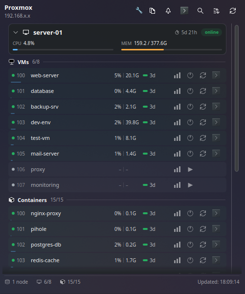
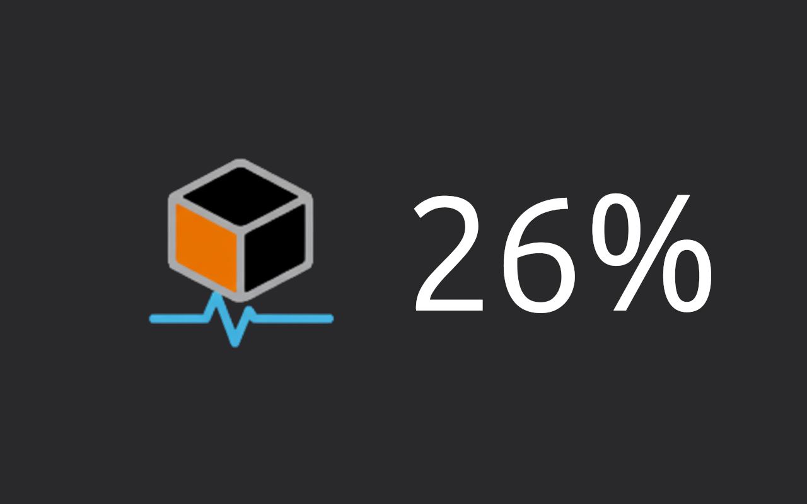
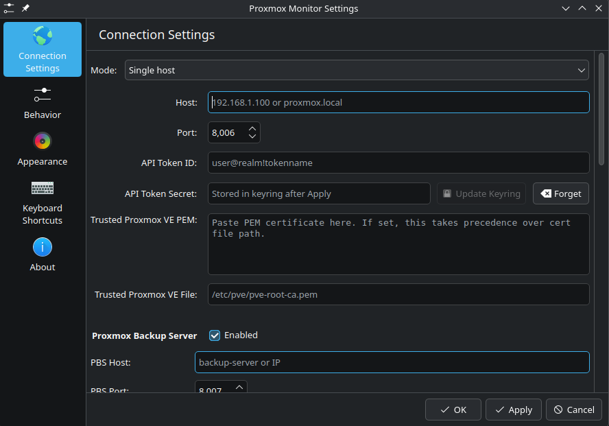

<div align="center">


<h1>ProxMon</h1>

<p><strong>Monitor your Proxmox VE servers straight from the KDE Plasma panel.</strong></p>

<p>Live node, VM &amp; container stats · in-widget VNC &amp; LXC consoles · PBS backup status · multi-host.</p>

<p>
  
  
  
  
  
  
</p>

<p>
  <a href="#installation">Install</a> ·
  <a href="#configuration">Configure</a> ·
  <a href="#security">Security</a> ·
  <a href="#troubleshooting">Troubleshooting</a>
</p>

</div>

---

<div align="center">
<table>
  <tr>
    <td rowspan="2" align="center" valign="middle"><div align="center">
      <br />
      <em>Expanded view: nodes, VMs &amp; containers</em>
    </div></td>
    <td align="center" valign="top"><div align="center">
      <br />
      <em>Compact panel label</em>
    </div></td>
  </tr>
  <tr>
    <td align="center" valign="top"><div align="center">
      <br />
      <em>Configuration</em>
    </div></td>
  </tr>
</table>
</div>

---

## Contents

- [Features](#features)
- [Requirements](#requirements)
- [Installation](#installation)
- [Proxmox API token setup](#proxmox-api-token-setup)
- [Proxmox Backup Server setup](#proxmox-backup-server-setup)
- [Configuration](#configuration)
- [Using KeePassXC](#using-keepassxc)
- [Security](#security)
- [Troubleshooting](#troubleshooting)
- [Contributing](#contributing)
- [Credits](#credits)
- [License](#license)
- [Changelog](#changelog)

## Features

| | |
| --- | --- |
| **Real-time monitoring** | Node status (CPU, memory, uptime) with VM and LXC container tracking |
| **VNC console** | GPU-accelerated in-widget VNC sessions with full keyboard, mouse, and scroll input |
| **LXC terminal** | Native terminal emulator for containers with automatic resize |
| **PBS backup status** | Inline backup results per VM/CT with configurable warning and stale thresholds |
| **Storage usage** | Per-node disk bars, the fullest store by default or the ones you name |
| **Multi-host** | Monitor up to 5 Proxmox endpoints simultaneously |
| **Power commands** | Start, stop, and restart VMs and containers |
| **Desktop notifications** | State-change alerts with rate limiting and filters |
| **Security controls** | API token auth, keychain storage, custom CA support, [scope and limitations below](#security) |
| **Appearance controls** | Custom running/stopped/node colors with live preview, card tint, window opacity |
| **Flexible panel label** | Show average CPU, running workloads, error state, or last update time |
| **Theme integration** | Adapts to your Plasma theme with per-color fallback to theme defaults |
| **Developer mode** | Triple-click the footer for verbose logging |

## Requirements

- KDE Plasma 6.0+
- Proxmox VE 7.0+ with API access
- Optional: the libsecret development package at build time, for KeePassXC support (`libsecret-1-dev`, `libsecret-devel` or `libsecret`). Without it ProxMon builds with KWallet only.

## Installation

```bash
git clone https://github.com/realstuffie/ProxMon.git
cd ProxMon
bash install.sh
```

The script handles dependencies, builds the native plugin, installs the plasmoid, and sets up an auto-rebuild watcher that detects library changes (e.g. libplasma soname bumps) and rebuilds automatically. Re-run with `--no-deps` to skip dependency installation on subsequent installs.

<details>
<summary><strong>Upgrading</strong></summary>

```bash
cd ProxMon
git pull
bash install.sh --no-deps
```

</details>

## Proxmox API Token Setup

1. Go to **Datacenter → Permissions → API Tokens → Add**
2. Set a user and token ID (e.g. `root@pam` / `plasma-monitor`)
3. Copy the secret immediately - shown only once

<details>
<summary><strong>Required permissions & example role</strong></summary>

**Minimum (read-only)**

| Permission  | Path    | Purpose                    |
|-------------|---------|----------------------------|
| `Sys.Audit` | `/`     | Read node status           |
| `VM.Audit`  | `/vms`  | Read VM & container status |

**Power actions**

| Permission      | Path   | Purpose                       |
|-----------------|--------|-------------------------------|
| `VM.PowerMgmt`  | `/vms` | Start/stop/reboot VMs and CTs |
| `Sys.PowerMgmt` | `/`    | Required in some role setups  |

**Console access**

| Permission   | Path   | Purpose                          |
|--------------|--------|----------------------------------|
| `VM.Console` | `/vms` | VNC console for VMs, TTY for LXCs |

**Storage usage**

| Permission        | Path        | Purpose                                  |
|-------------------|-------------|------------------------------------------|
| `Datastore.Audit` | `/storage`  | Read each node's storage usage (optional) |

> **Note:** `Datastore.Audit` is part of `PVEAuditor`, so a token with that role already has it. Proxmox returns an empty list instead of an error when the permission is missing, so ProxMon says which permission to grant. Turn off **Storage Usage** in settings if you would rather not grant it.

**Stats panel (guest IP)**

| Permission          | Path   | Purpose                                         |
|---------------------|--------|-------------------------------------------------|
| `VM.GuestAgent.Audit` | `/vms` | Read guest IP via the QEMU agent (VMs only; optional) |

> **Note:** `VM.GuestAgent.Audit` is only needed to show a VM's IP in the stats panel, and only for VMs (it uses the QEMU guest agent). Without it, the CPU/mem graph still works and the IP simply shows N/A. Container IPs need no extra permission.

> **Privilege Separation note:** if your token has privilege separation enabled, effective permissions are the *intersection* of user and token permissions. Grant roles to both, or disable privilege separation.

**Example: dedicated monitoring user**

```bash
pveum user add monitor@pve -comment "Plasma Monitor"
pveum aclmod / -user monitor@pve -role PVEAuditor
pveum user token add monitor@pve plasma-monitor
```

</details>

## Proxmox Backup Server Setup

1. **Configuration → Access Control → Users → Add.** Create e.g. `proxmon@pbs`
2. **Configuration → Access Control → API Tokens → Add.** Select the user, set a token name
3. **Configuration → Access Control → Permissions → Add.** Path `/datastore/YourDatastoreName`, role `DatastoreReader`. Copy the token secret (shown only once).

Token ID format: `user@pbs!tokenname`

<details>
<summary><strong>Minimum PBS permissions</strong></summary>

| Role                         | Path                | Purpose                              |
|------------------------------|---------------------|--------------------------------------|
| `DatastoreReader` (built-in) | `/datastore/<name>` | Read datastore and snapshot listings |

</details>

**Sharing one PBS across multiple Proxmox endpoints:** set **PBS Datastore** and **PBS Namespace** for each endpoint to the location used by that cluster. An empty datastore searches all visible stores. Namespace `*` searches all visible namespaces; an empty namespace selects root only. Named namespaces match exactly, without including their children.

ProxMon keeps backup sources separate by datastore and namespace. If multiple sources match the same guest, its backup marker shows `?` with an explanation instead of choosing the newest backup. Select the correct source in settings to resolve it. You can also restrict each endpoint's PBS token to its cluster's backups. ProxMon cannot infer which cluster owns a backup from its VMID alone, so use explicit filters when sharing PBS across clusters.

## Configuration

Right-click the widget → **Configure Proxmox Monitor**.

- **Connection.** Host, Port, Token ID (`user@realm!tokenname`), Token Secret, SSL verification, trusted cert PEM or file path, refresh interval. Click **Update Keyring** after changing the secret.
- **Storage usage.** **Storage Usage** turns the node card's disk bars on or off, per endpoint. **Storage Monitored** takes storage names separated by commas, and each name gets its own bar. Leave it empty and ProxMon tracks the fullest store holding guest disks, meaning content `images` or `rootfs`. Bars turn amber at 75% and red at 90%. The tooltip lists every monitored store.
- **Behavior.** Sorting, compact panel label mode (Avg CPU, running workloads, error state, last update), notifications, rate limiting, privacy (redact token fragments in notifications).
- **Appearance.** Custom running/stopped/node colors, per-color hex or RGB input, card tint opacity, window opacity, live preview with one-click theme defaults.
- **Keyring.** By default QtKeychain picks the keyring, which is KWallet on Plasma. The KeePassXC option on the Keyring tab stores token secrets in KeePassXC instead. See [Using KeePassXC](#using-keepassxc).

## Using KeePassXC

ProxMon can store its token secrets in KeePassXC through the freedesktop Secret Service. KeePassXC still handles unlocking, so a database protected by a password, a key file and a YubiKey works the same as it does for any other program.

**1. Enable the Secret Service in KeePassXC.** Open Tools, Settings and turn on Secret Service Integration. Then open Database Settings, go to Secret Service Integration and expose a group. Make a new group for this and put nothing else in it, because every program in your session can read every entry under the exposed group. Menu names differ a little between KeePassXC versions.

**2. Make sure KeePassXC owns the Secret Service.** Only one program can own `org.freedesktop.secrets` on the session bus. GNOME Keyring and KDE's `ksecretd` can both claim it, and D-Bus starts them on demand, so they often get there first. If one of them owns the name, ProxMon stores its secrets there without telling you. Find the owner with:

```bash
busctl --user status org.freedesktop.secrets
```

`Comm=` names the program. If it says `gnome-keyring-d`, stop it from claiming the name:

```bash
systemctl --user mask --now gnome-keyring-daemon.service gnome-keyring-daemon.socket
```

Some distros also start it from an autostart entry. If it comes back after a login, copy `/etc/xdg/autostart/gnome-keyring-secrets.desktop` to `~/.config/autostart/` and add `Hidden=true` to the copy. Log out and back in, start KeePassXC and run the `busctl` command again. The owner should now be `keepassxc`. If `ksecretd` owns the name, the same check applies. The Keyring tab shows the current owner and warns when it isn't KeePassXC. Press **Check again** after each change.

This switches the Secret Service for your whole desktop, not only ProxMon. Browsers, Evolution, Remmina and the GitHub CLI all keep secrets there. Chrome's Safe Storage key decides whether it can read its saved passwords, so a browser that loses the key loses that data. Copy the entries you want to keep into KeePassXC before you switch, or expect to sign in again.

**3. Turn the option on.** Tick the KeePassXC option, press Apply and restart Plasma. The Keyring section shows a **Restart Plasma** button while a restart is due. Press Apply first, because the restart reloads every panel and closes the dialog. To restart by hand:

```bash
kquitapp6 plasmashell && kstart plasmashell
```

QtKeychain picks its keyring at the first access, so the option only takes effect after a restart. Until then the widget keeps using the old keyring, and saving a token or importing still goes there. ProxMon removes the variable it sets from Plasma's environment after that first access, so programs started from the panel don't inherit it. A `QTKEYCHAIN_BACKEND` already in your environment wins over the option. Older ProxMon versions set `kwallet6` inside plasmashell, and a terminal started from that session keeps it. Run `unset QTKEYCHAIN_BACKEND` first if the page reports an override.

**4. Move your secrets.** The option does not move secrets already in KWallet. After the restart, press **Import secrets from KWallet** and then Apply. ProxMon copies each token secret into KeePassXC, keeps any entry that already exists there and deletes nothing from KWallet. KeePassXC may ask you to unlock the database, which includes a YubiKey touch. A notification and the line under the button show the result. Once everything works you can delete the old entries in KWalletManager.

**A locked database pauses monitoring.** ProxMon holds a token secret in memory only while a request is in flight, and it reads the secret from the keyring on every refresh. A locked KeePassXC database can't hand one out, so monitoring pauses until you unlock it. ProxMon checks the lock state first, so it doesn't open an unlock dialog on every refresh. The panel shows "KeePassXC is locked. Unlock it to resume." and retries as soon as you unlock the database, or on its backoff if that announcement is missed. Import and Update Keyring do open the dialog, because you asked for them. Caching the token would avoid the pause but break the in-flight-only rule, so ProxMon doesn't. Your options:

- Keep the database unlocked while you want monitoring. That means turning auto-lock off.
- Lock only on screen lock or suspend, not after a timeout.
- Stay on KWallet on this machine. The KeePassXC option is off by default, and KWallet unlocks once at login.

**Limits.** Restoring endpoints from stored keys when the config is empty works with KWallet and with KeePassXC. If QtKeychain falls back to the Secret Service on its own because KWallet is missing, saving and reading secrets work but that restore does not. The wake-up on unlock depends on the provider announcing it. KeePassXC does, with a collection-changed signal. If another provider doesn't, ProxMon retries on its backoff, from 30 seconds up to 10 minutes.

## Security

- **Keychain storage.** ProxMon stores API token secrets through QtKeychain, not in its plaintext configuration. Runtime operations read them on demand without a client-wide token cache. Storage protection and access permissions depend on the system keyring backend.
- **Runtime UI handling.** Normal runtime operations keep resolved API secrets, authorization headers and console tickets in C++, outside QML/JavaScript values. Credential entry is an exception: a secret typed into settings passes through QML before storage. Clearing the field does not guarantee erasure of its backing memory.
- **Memory lifetime.** API secrets and authorization headers are intended to be request-scoped; console tickets may remain in memory for the console session. Current cleanup does not guarantee erasure: Qt's copy-on-write buffers can detach during a wipe, and request, WebSocket and TLS internals can retain copies. See the [credential security model](docs/ARCHITECTURE.md#credential-security-model).
- **Protection limits.** ProxMon does not isolate credentials from unrestricted processes running as the same user, privileged attackers, or malicious code inside plasmashell. An unlocked system wallet may allow other user processes to read its entries. Complete erasure from memory, swap or core dumps is not guaranteed.
- **SSL/TLS.** Connections use HTTPS/WSS. Supply your own CA certificate for self-signed setups. "Ignore SSL" bypasses certificate verification, not encryption, and allows server impersonation. Keep verification enabled to protect credentials in transit.
- **Notification privacy.** Token identifiers are redacted from desktop notifications by default.
- **Local console bridge.** The VNC console uses a loopback socket between the native VNC client and the Proxmox WebSocket endpoint. Another local process can race the client for that connection and disrupt console setup. This bridge is not a process-isolation boundary.

## Troubleshooting

<details>
<summary><strong>Connection errors / "!" indicator</strong></summary>

- Verify token ID format: `user@realm!tokenname`
- For self-signed Proxmox certs, prefer adding the Proxmox root CA PEM (usually `/etc/pve/pve-root-ca.pem`) in widget settings before using **Ignore SSL**.
- Trusted certs only fix issuer trust; the configured host must still match a hostname or IP SAN on the server certificate.
- If your cert is valid only for an internal hostname, add local DNS or an `/etc/hosts` entry and use that hostname in the widget instead of the raw IP.
- Check port 8006 is accessible.

</details>

<details>
<summary><strong>Icons not showing</strong></summary>

```bash
cp contents/icons/*.svg ~/.local/share/icons/hicolor/scalable/apps/
gtk-update-icon-cache ~/.local/share/icons/hicolor/
quitapp6 plasmashell && kstart plasmashell
```

</details>

<details>
<summary><strong>Widget not appearing after install</strong></summary>

```bash
kquitapp6 plasmashell && kstart plasmashell
```

If your distro blocks loading the packaged native plugin path:

```bash
bash install.sh --install-standalone-qml-module
```

</details>

<details>
<summary><strong>Logs & auto-rebuild watcher</strong></summary>

```bash
journalctl --user -f | grep -i proxmox
journalctl --user -g 'ProxMon keyring'   # keyring failures, logged without developer mode
systemctl --user status proxmox-plasmoid-rebuild.path
tail -f ~/.local/share/plasma/plasmoids/org.kde.plasma.proxmox/rebuild.log
```

</details>

<details>
<summary><strong>Known bugs / limitations</strong></summary>

- If you configured the widget in older versions, your API token secret may have been stored under a slightly different keyring key (e.g. due to host casing/whitespace). Legacy keys are no longer auto-migrated and can break the widget. If you see "Missing Token Secret" or odd behavior, open KWallet, remove any ProxMon-related entries, re-enter the secret in settings, and click **Update Keyring**. Wait a moment, or log out and back in.
- **LXC terminal resize, reflow not guaranteed.** Resizing the terminal window sends `SIGWINCH` to the running process, but reflow behavior varies by application. Shells and editors usually redraw correctly; other programs may not reflow until the next render or keypress. This is a quirk of most terminal emulators, not specific to ProxMon.

</details>

## Contributing

Open an issue with your KDE Plasma version (`plasmashell --version`), Proxmox VE version, steps to reproduce, and relevant log output.

<details>
<summary><strong>Running the unit tests</strong></summary>

Build and run the native Qt tests separately from the production plugin build:

```bash
cmake -S contents/lib -B build-tests -DPROXMON_BUILD_TESTS=ON -DCMAKE_BUILD_TYPE=Debug
cmake --build build-tests --parallel
ctest --test-dir build-tests --output-on-failure
```

</details>

<details>
<summary><strong>Uninstall</strong></summary>

```bash
./uninstall.sh
```

Or manually:

```bash
kpackagetool6 -t Plasma/Applet -r org.kde.plasma.proxmox
rm -f ~/.local/share/icons/hicolor/scalable/apps/proxmox-monitor.svg
rm -f ~/.local/share/icons/hicolor/scalable/apps/lxc.svg
```

</details>

## Credits

- [Proxmox VE](https://www.proxmox.com/), virtualization platform
- [KDE Plasma](https://kde.org/plasma-desktop/), desktop environment
- [noVNC](https://github.com/novnc/noVNC), DOM key table ported from `core/input/domkeytable.js` (MPL 2.0)
- [QTermWidget](https://github.com/lxqt/qtermwidget), LXC terminal emulator widget (LGPL-2.0+)
- [LibVNCClient](https://github.com/LibVNC/libvncserver), VNC client support (GPL-2.0-or-later)
- [QtKeychain](https://github.com/frankosterfeld/qtkeychain), secure credential storage (BSD-3-Clause)

### Unit tests

Build and run the native Qt tests separately from the production plugin build:

```bash
cmake -S contents/lib -B build-tests -DPROXMON_BUILD_TESTS=ON -DCMAKE_BUILD_TYPE=Debug
cmake --build build-tests --parallel
ctest --test-dir build-tests --output-on-failure
```

## License

GPL-3.0 or later. See [LICENSE](License) for details.

## Changelog

<details>
<summary><strong>v0.8.6</strong> (latest)</summary>

- Auto-retry gives up after 6 attempts and now also runs in multi-host mode
- Only DNS failures and timeouts mark a host unreachable, so a proxy's "Gateway Timeout" no longer marks an endpoint offline
- Fixes for the first refresh after startup, the stuck spinner after a cancel and the filter button
- VNC console uploads only the changed parts of the screen

See [CHANGELOG.md](CHANGELOG.md) for the full release history.

</details>

<details>
<summary><strong>v0.8.5</strong></summary>

- Node cards show per-node storage usage, with a bar per store you name
- PBS backups are matched per datastore and namespace, so clusters sharing one PBS no longer collide on VMID
- Keyring failures are logged to the journal and no longer re-prompt on every refresh
- Settings export and import carry the custom guest order

See [CHANGELOG.md](CHANGELOG.md) for the full release history.

</details>

<details>
<summary><strong>v0.8.4</strong></summary>

- Reworked expanded panel with node usage meters and clearer guest actions
- Guest filtering by name or ID and sorting controls in the panel header
- Custom guest ordering with drag and drop, saved per cluster
- Explanations for missing guest IP addresses
- VNC consoles stay connected when QEMU changes screen size

See [CHANGELOG.md](CHANGELOG.md) for the full release history.

</details>

<details>
<summary><strong>v0.8.1</strong></summary>

- New: toggle to enable/disable the stats panel, independent of power actions
- Fixed: action-button reservation width now tracks enabled features, no dead space when toggled off

</details>

<details>
<summary><strong>v0.8.0</strong></summary>

- Fix: honor configured trusted CA on VNC/LXC WebSocket connections
- Fix: auto-retry timer now schedules the retry after the computed backoff
- Fix: wire lowLatency setting through to request timeouts
- Fix: stop killing error/retry status bindings with imperative writes
- Fix: KCM Restore Defaults no longer enables Ignore SSL
- Fix: collapse duplicate PBS refresh at startup
- Chore: drop dead PBS test button handlers
- Fix: coerce host-shell visible binding to bool
- Docs: sync ARCHITECTURE/developer notes with current code
- Feat: Backup / Restore section for exporting and importing all settings
- Refactor: Default Settings uses the same export format as Backup/Restore
- Refactor: startup defaults seed applies the full validated envelope
- Test: QML logic suite wired into CTest for config portability
- Feat: per-VM/CT stats panel with CPU/mem sparkline and best-effort IP
- Fix: missing right margin on node card

</details>

<details>
<summary><strong>v0.7.3</strong></summary>

- Refactor: node card header, status pill replaces computer icon, always-visible VM/CT counts
- Refactor: uptime shows alarm icon, JetBrains Mono font, right-aligned in stats row
- Chore: remove legacy secret key candidate fallback chain
- Fix: isolate task poll requests from refresh cancellation to prevent stuck busy spinner
- Fix: clear busy spinner via checkStateChanges safety-net when onActionReply never fires
- Fix: UI alignment and field sizing across all config tabs for consistent cross-distro rendering
- Fix: move SSL toggles into single/multi-host sections; hide PBS fields when disabled
- Fix: add Delete Default button to connection defaults section
- Fix: label and dropdown alignment in Behavior and Appearance tabs
- Refactor: drop VNC remote resize (SetDesktopSize); simplify encoding string
- Fix: ctrl+key keysym recovery in VNC console when modifiers suppress text
- Fix: use explicit_bzero for ticket zeroization; null client-data slot before free
- Chore: update lxc/vm icons

</details>

<details>
<summary><strong>v0.7.2 · v0.7.1 · v0.7.0 · v0.6.x</strong></summary>

**v0.7.2**

- Fix: bundle JetBrains Mono for consistent cross-distro font metrics
- Fix: monospace text vertical centering in VM and LXC rows
- Tested on Ubuntu 26 (KDE 6.6.4), Fedora 44 (KDE 6.6.5), Manjaro (KDE 6.6.5), openSUSE Tumbleweed (KDE 6.6.5)

**v0.7.1**

- Fix: normalize row spacing, monospace stats labels, vertical centering in VM and LXC rows
- Fix: tighten stats block and mem label width to close visual gap between cpu/mem and PBS column
- Fix: add left margin to power buttons; reduce row left margin 8→4px
- Fix: extend backup age display to weeks (7d+) and years (52w+)
- Fix: checksum-based install sync; skip kpackagetool re-register if already installed
- Fix: move notification toggle to Behavior tab; bind via bool prop
- Fix: treat task WARNINGS as non-fatal

**v0.7.0**

- Power actions toggle: enable/disable start/stop/restart buttons per endpoint
- LXC terminal: reworked data path with copy/paste support
- SSL warning text now uses bright red; security warnings added to ignore SSL toggles
- Renamed Console section to Features in behavior settings
- Install: extended auto-rebuild watcher to cover Qt6, libvncclient, qtermwidget6
- Install: added `--no-watcher` flag to skip auto-rebuild watcher setup
- Build: mold linker support

**v0.6.1**

- Fix: closing the VNC console window during connection no longer crashes plasmashell (use-after-free + deadlock in teardown path)
- Fix: PBS in-flight requests now correctly aborted by `cancelAll()` alongside PVE requests
- Fix: per-endpoint SSL certificate now correctly passed to VNC and TTY proxy requests in multi-host mode
- Docs: added Security section to README

**v0.6.0**

- VNC console for VMs: GPU-accelerated rendering, full keyboard/mouse/scroll, dynamic resize, auto-reconnect
- LXC terminal: native terminal emulator with automatic resize and wake support for silent containers
- Credentials handled securely in C++: tickets and auth headers never exposed to QML
- Multi-host trusted cert toggle: shared or per-endpoint
- Various config and stability fixes; bump bundled QtKeychain

</details>
